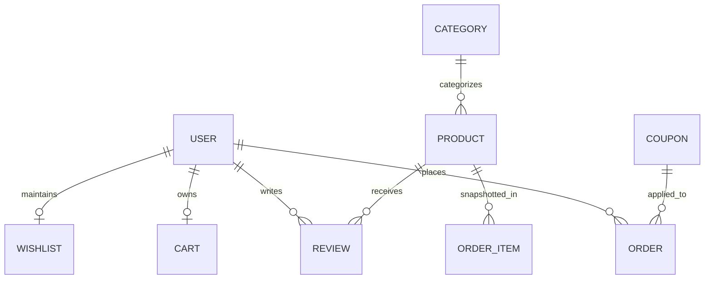

# AUTOX — Database Architecture & Schema Specification

Engine: `MongoDB (Mongoose ODM)`  
Zero-Config Dev Support: `Embedded MongoDB (mongodb-memory-server fallback)`  
Production Protocol: `MongoDB Connection URI (Atlas / Dedicated Server)`

---

## 1. Entity-Relationship Overview

---

## 2. Model Schemas & Indexing

### A. User Schema (`User.js`)
- `name`: String (Required, trimmed, max 100)
- `email`: String (Required, unique, lowercase, indexed)
- `password`: String (Required, select: false, bcrypt hashed with 10 salt rounds)
- `phone`: String (Optional)
- `role`: Enum `['customer', 'admin']` (Default: `'customer'`)
- `avatar`: String
- `addresses`: Subdocument Array `[AddressSchema]`
- `isActive`: Boolean (Default: `true`)
- `isEmailVerified`: Boolean (Default: `true`)
- `passwordResetToken`: String (Sha256 hash)
- `passwordResetExpires`: Date (1 hour TTL)
- `timestamps`: `createdAt`, `updatedAt`

### B. Product Schema (`Product.js`)
- `name`: String (Required, max 200, indexed)
- `slug`: String (Required, unique, URL-safe slugified)
- `SKU`: String (Required, unique, uppercase, indexed)
- `description`: String (Required)
- `shortDescription`: String
- `category`: ObjectId (Ref `Category`, required, indexed)
- `brand`: String (Required, indexed)
- `price`: Number (Required, min 0, PKR, indexed)
- `discountPercentage`: Number (0 to 100, default 0)
- `stock`: Number (Required, min 0)
- `images`: Array of Strings (URLs or local paths)
- `model3D`: String (URL to optional GLB/GLTF asset)
- `specifications`: Array of `{ key: String, value: String }`
- `ratingAverage`: Number (0 to 5, default 0, rounded to 1 decimal)
- `ratingCount`: Number (Default 0)
- `isFeatured`: Boolean (Indexed)
- `isBestSeller`: Boolean (Indexed)
- `isActive`: Boolean (Default `true`)
- `timestamps`: `createdAt`, `updatedAt`
- **Text Index**: `{ name: 'text', description: 'text', brand: 'text' }` for lightning-fast multi-keyword catalog search.

### C. Category Schema (`Category.js`)
- `name`: String (Required, unique)
- `slug`: String (Required, unique, indexed)
- `description`: String
- `image`: String
- `isActive`: Boolean (Default `true`)
- `timestamps`

### D. Cart Schema (`Cart.js`)
- `user`: ObjectId (Ref `User`, optional, unique sparse index)
- `sessionId`: String (Optional, for guest checkout persistence)
- `items`: `[{ product: ObjectId, quantity: Number, price: Number }]`
- `coupon`: Subdocument `{ code, discountType, discountValue, calculatedDiscount }`
- `timestamps`

### E. Order Schema (`Order.js`)
- `orderNumber`: String (Required, unique, format `AOX-YYYYMMDD-XXXX`)
- `user`: ObjectId (Ref `User`, required, indexed)
- `items`: Array of snapshotted items:
  - `product`: ObjectId
  - `name`: String (Preserves item name at moment of purchase)
  - `SKU`: String (Preserves SKU at purchase)
  - `price`: Number (Authoritative price at order creation)
  - `quantity`: Number
  - `image`: String
- `shippingAddress`: Subdocument with street, city, province, postalCode, phone
- `subtotal`: Number
- `shippingFee`: Number
- `discount`: Number
- `total`: Number (Authoritative grand total in PKR)
- `coupon`: `{ code, discountAmount }`
- `paymentMethod`: Enum `['cod', 'simulated_card']`
- `paymentStatus`: Enum `['pending', 'completed', 'failed', 'refunded']`
- `orderStatus`: Enum `['placed', 'confirmed', 'processing', 'shipped', 'delivered', 'cancelled']`
- `deliveryTracking`: Array of `{ status, message, location, timestamp }`
- `cancellationReason`: String
- `refundDetails`: `{ amount, reason, processedAt }`
- `timestamps`

### F. Review Schema (`Review.js`)
- `user`: ObjectId (Ref `User`, required)
- `product`: ObjectId (Ref `Product`, required)
- `order`: ObjectId (Ref `Order`, verifies purchase)
- `rating`: Number (1 to 5)
- `title`: String
- `comment`: String
- `status`: Enum `['pending', 'approved', 'hidden']`
- **Unique Compound Index**: `{ product: 1, user: 1 }` (Enforces 1 review per customer per equipment)

### G. Coupon Schema (`Coupon.js`)
- `code`: String (Required, unique, uppercase)
- `discountType`: Enum `['percentage', 'fixed']`
- `discountValue`: Number
- `minimumOrderAmount`: Number (Default 0 PKR)
- `maximumDiscount`: Number (Cap for percentage discounts)
- `startDate`: Date
- `expiryDate`: Date
- `usageLimit`: Number
- `usageCount`: Number
- `perUserLimit`: Number
- `usedBy`: `[{ user: ObjectId, count: Number }]`
- `isActive`: Boolean

---

## 3. Resilience & Zero-Config Dev Strategy

The database connector (`server/config/db.js`) detects whether a local MongoDB daemon is running at `127.0.0.1:27017`. If an external cluster is unreachable during development or testing, it activates an embedded `MongoMemoryServer` instance. This ensures:
1. Automated unit & integration tests run everywhere with zero local daemon requirements.
2. Students, professors, and evaluating committees can run `npm run dev` or `npm run seed` straight out of the box.

